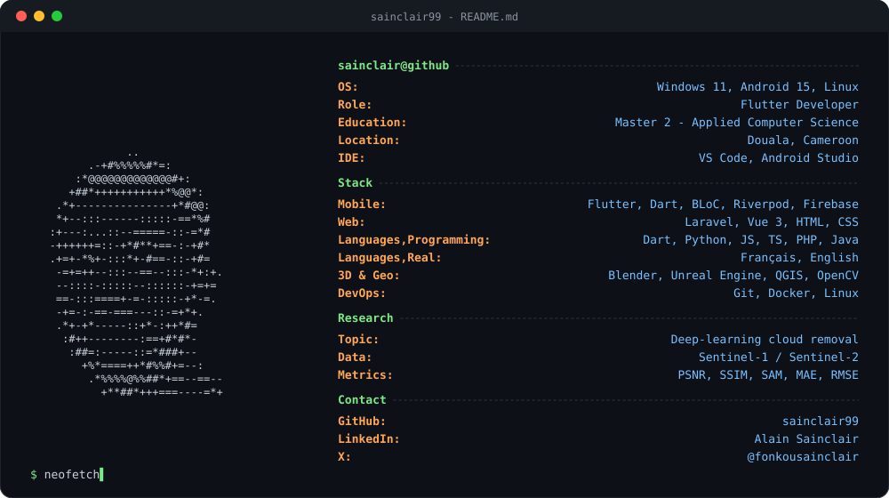
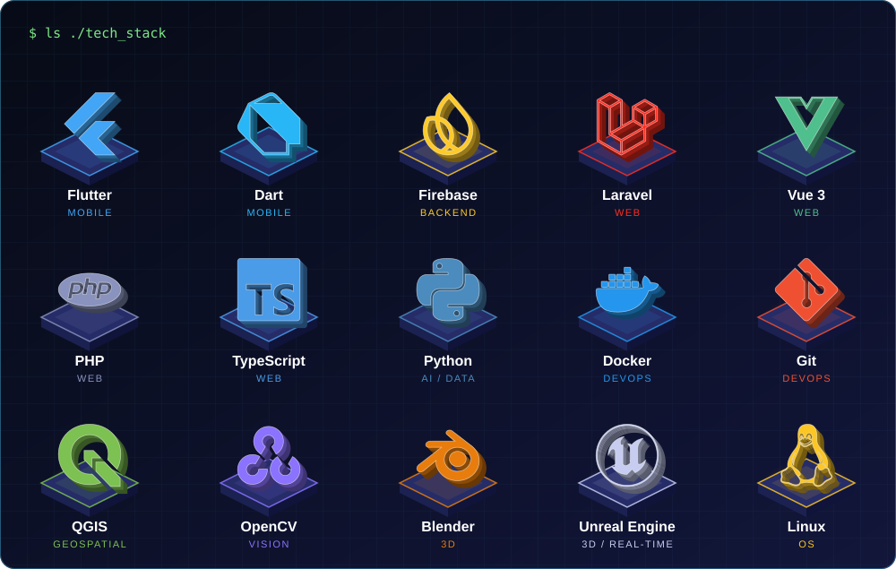

 

 

 

  

 

## 👨‍💻 About me

> **Flutter developer** with a Master 2 in Applied Computer Science, based in **Douala, Cameroon**.
> I build mobile and web apps, and research **deep-learning methods to remove clouds from satellite imagery**.

<table>
<tr>
<td width="50%" valign="top">

### 🔭 Currently

- 📱 Building with **Flutter** (BLoC / Cubit)
- 🌐 Web apps with **Laravel** & **Vue 3**
- 🛰️ Master 2 research on cloud removal

</td>
<td width="50%" valign="top">

### 🌱 Exploring

- 🧊 3D modeling with **Blender**
- 🎮 Real-time worlds with **Unreal Engine**
- 🧠 Satellite image processing & AI

</td>
</tr>
</table>

## 🧰 Tech stack

  

  
  
  
  
  
  
  
  
  
  
  
  
  

## 🚀 What I build

|     | Project                      | Description                                                                                                                    |
| --- | ---------------------------- | ------------------------------------------------------------------------------------------------------------------------------ |
| 📱  | **Flutter applications**     | Maintainable mobile UIs, BLoC/Cubit state management, API integration, local persistence.                                      |
| 🎟️  | **Event Pass**               | Event management, organizer workflows, team management and QR-code ticketing.                                                  |
| ✅  | **Tasks Memo**               | Task management, filters, local storage and scheduled notifications.                                                           |
| 🎵  | **Cameroonian music lyrics** | [Kamer_Lyrics](https://github.com/sainclair99/Kamer_Lyrics) and [africa_lyrics](https://github.com/sainclair99/africa_lyrics). |
| 🌐  | **Web applications**         | Full-stack apps with Laravel (API & back-office) and Vue 3 front-ends.                                                         |
| 🧊  | **3D modeling**              | Assets and scenes created in Blender.                                                                                          |

## 🛰️ Research lab

<b>Deep-learning cloud removal for optical satellite imagery</b>

 

- 🛰️ **Data**: Sentinel-2 optical imagery and Sentinel-1 radar
- ☁️ **Preprocessing**: MAJA and S1Tiling
- 🧠 **Inference** with pretrained cloud-removal models (no retraining when the experiment is inference-only)
- 📊 **Evaluation**: PSNR · SSIM · SAM · MAE · RMSE
- 🗺️ **Workflow**: reproducible pipelines with Python, QGIS and Docker

## 📊 GitHub stats

## 📫 Let's connect

 

